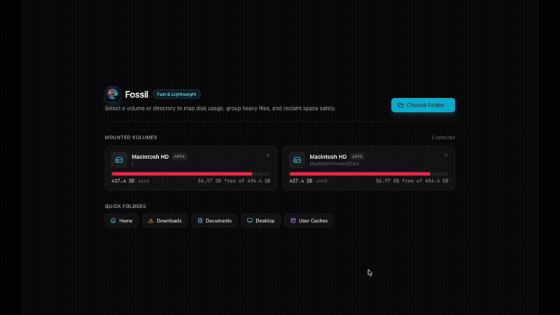

<p align="center">
  
</p>

# Fossil - Instant Disk Space Analyzer for macOS, Windows & Linux

[](#works-everywhere---modern-and-older-systems)
[](#why-fossil)
[](#why-fossil)
[](#3-connect-to-ai-assistants-mcp)

**See where every gigabyte goes in seconds.**

**Fossil** is a fast, lightweight **disk usage analyzer and storage cleaner** built for **macOS, Windows, and Linux**. It scans entire drives in seconds using all your CPU cores, turns millions of files into a crisp, interactive visual map, automatically groups space hogs, and helps you reclaim storage safely, without ever slowing down your computer.

Use Fossil however you work best: as a **sleek native desktop app**, a **lightning-fast command-line tool**, or an **AI-ready MCP server** for assistants like Claude, Cursor, and Antigravity.

> **Lightweight by design:** Unlike bulky Electron apps that eat hundreds of megabytes of RAM and 120+ MB of disk space just to open, Fossil installs in **~6-12 MB**, launches instantly, and stays whisper-quiet on memory, even on million-file drives.

---

## See Fossil in Action

Pick any drive or folder and map your entire storage in seconds, with instant visual breakdowns and safe one-click cleanup:

<p align="center">
  
</p>

---

## Why Fossil?

- **Scan Entire Drives in Seconds** - Uses every core of your processor to scan and search hundreds of thousands of files while keeping the interface buttery smooth.
- **Tiny Footprint, Zero Bloat** - Native performance and a fraction of the RAM and download size of typical desktop apps.
- **Spot Heavy Folders & Giant Files Instantly** - An interactive, zoomable **Treemap** scales every file and folder proportionally by size so storage hogs jump off the screen.
- **Automatic Smart Grouping** - Instantly see how much space goes to **Videos**, **Disk Images & VMs**, **Archives**, **Photos**, **Audio**, **Documents**, **Apps**, and **regeneratable developer bloat** (`node_modules`, `target`, `DerivedData`, `.venv`, caches).
- **Safe, One-Click Cleanup** - Reveal any file directly in **Finder**, **File Explorer**, or your **Linux File Manager**. Deletions go to your **Trash / Recycle Bin** first, critical system folders are protected, and the view updates immediately without rescanning.
- **Cloud-Smart & 100% Private** - Never triggers accidental iCloud or OneDrive downloads, works completely offline, and never sends your file names or data anywhere.
- **Desktop + CLI + AI (MCP)** - Seamlessly powers a visual desktop app, a standalone terminal tool, and a built-in Model Context Protocol (MCP) server.

---

## Quick Start

### Download Ready-to-Use Installers

Click your platform below to download the latest installer directly:

| Platform                    | Direct Download                                                                                                            | Notes                  |
| :-------------------------- | :------------------------------------------------------------------------------------------------------------------------- | :--------------------- |
| **macOS (Apple Silicon)**   | [Fossil-macos-arm64.dmg](https://github.com/meghrazchi/fossil/releases/latest/download/Fossil-macos-arm64.dmg)             | M1 / M2 / M3 / M4 Macs |
| **macOS (Intel)**           | [Fossil-macos-x64.dmg](https://github.com/meghrazchi/fossil/releases/latest/download/Fossil-macos-x64.dmg)                 | Intel Macs             |
| **Windows (64-bit)**        | [Fossil-windows-x64-setup.exe](https://github.com/meghrazchi/fossil/releases/latest/download/Fossil-windows-x64-setup.exe) | Standard installer     |
| **Linux (AppImage)**        | [Fossil-linux-x64.AppImage](https://github.com/meghrazchi/fossil/releases/latest/download/Fossil-linux-x64.AppImage)       | Works on most distros  |
| **Linux (Debian / Ubuntu)** | [Fossil-linux-x64.deb](https://github.com/meghrazchi/fossil/releases/latest/download/Fossil-linux-x64.deb)                 | `.deb` package         |

Looking for **standalone CLI / MCP binaries**, **Windows `.msi`**, **Linux `.rpm`**, or **SHA256 checksums**? Visit the **[`downloads/`](./downloads/README.md)** hub (or browse [GitHub Releases](https://github.com/meghrazchi/fossil/releases)).

### Or Build From Source

```bash
git clone https://github.com/meghrazchi/fossil.git
cd fossil

# Run the Desktop App
pnpm install
pnpm tauri dev

# Or build only the lightweight standalone CLI + MCP binary (Rust only)
cargo build --release -p fossil-cli
```

---

## How to Use Fossil

### 1. Desktop App - Visual Storage Explorer

1. **Pick a Drive or Folder:** Open Fossil to see all connected drives with live usage bars, click a quick folder (`Home`, `Downloads`, `Documents`, `Desktop`), or choose any custom folder.
2. **Zoom & Explore:**
   - **Hover** over any block to inspect its exact location, **Disk Usage vs. Logical Size**, category, and last modified date.
   - **Double-click** any folder to zoom straight in; click the breadcrumb bar or press `Backspace` to zoom back out.
   - **Click any category** in the top color bar (for example, _Videos_ or _Code & Build_) to focus the entire view on that file type.
3. **Find & Reclaim Space:**
   - Switch between **Largest Files**, **By Category**, **By Extension**, **Heavy Bloat Dirs**, and **Size & Age Groups** in the bottom panel.
   - **Right-click** any file or folder to **Reveal in File Manager**, **Copy Path**, or **Move to Trash** safely.

#### Keyboard Shortcuts

| Shortcut                     | Action                                                   |
| :--------------------------- | :------------------------------------------------------- |
| `Cmd/Ctrl + F`               | Search and filter files                                  |
| `Backspace`                  | Go up to parent folder                                   |
| `Cmd/Ctrl + R`               | Reveal selected item in Finder / Explorer / File Manager |
| `Delete` / `Cmd + Backspace` | Move selected item safely to Trash / Recycle Bin         |
| `Escape`                     | Close menu                                               |

---

### 2. Command-Line Tool (`fossil`)

Need quick answers in your terminal, scripts, or over SSH? Fossil ships with a fast, zero-GUI command-line binary:

```bash
# Scan a folder and see a breakdown by category + top space hogs
fossil scan ~/Projects --top 15 --group category

# Search across all CPU cores for specific files
fossil search ~/Projects "backup" --ext zip

# Find the 20 largest videos older than 6 months
fossil largest ~ --limit 20 --category video --min-age-days 180

# Discover regeneratable build & cache folders you can safely clear
fossil bloat ~/Projects

# Check connected drives and available space
fossil volumes

# Safely move files or folders to the OS Trash
fossil trash ~/Downloads/old-installer.dmg

# Highlight a file in Finder / Explorer / File Manager
fossil reveal ~/Downloads/archive.zip
```

> Add `--json` to `scan`, `search`, `largest`, `bloat`, or `volumes` for clean machine-readable output in scripts and automations.

---

### 3. Connect to AI Assistants (MCP)

Fossil includes a built-in **MCP (Model Context Protocol)** server so AI assistants like **Claude Desktop**, **Cursor**, and **Antigravity** can inspect your storage, search files across all CPU cores, find build bloat, and safely move unwanted files to Trash on your behalf.

Add Fossil to your MCP client configuration:

```json
{
  "mcpServers": {
    "fossil": {
      "command": "/absolute/path/to/fossil",
      "args": ["mcp"]
    }
  }
}
```

**Try asking your AI assistant:**

- _"Scan my `~/Projects` folder with Fossil and show me which build caches are taking the most space."_
- _"Find all `.mov` and `.mp4` files over 500 MB in `~/Downloads`."_
- _"Break down my Home folder by file extension and list the 15 largest files."_

---

## Works Everywhere - Modern and Older Systems

Fossil automatically adapts to your computer:

- **Full speed on modern hardware:** Takes advantage of fast native OS features on modern macOS, Windows, and Linux systems with zero extra setup.
- **Smooth compatibility on older OS versions & external drives:** Automatically switches to compatible fallback methods on older macOS/Linux/Windows versions or external/network drives (exFAT, FAT32, SMB, FUSE) without slowing down modern systems.

---

## Technical Architecture & Contributing

Want to explore how Fossil achieves its speed, memory efficiency, binary treemap streaming, legacy OS fallbacks, and multi-OS CI/CD pipeline?

- Read the full engineering deep-dive in **[ARCHITECTURE.md](./ARCHITECTURE.md)**
- Read the product & feature specification in **[SPEC.md](./SPEC.md)**

---

## FAQ

**Does Fossil slow down my computer during a full-drive scan?**
No. Scans run asynchronously in the background while keeping the interface responsive, and you can stop a scan at any moment.

**Will scanning download my iCloud Drive or OneDrive files?**
No. Fossil recognizes cloud-only placeholder files without reading their contents, reporting `0 B` of local disk usage so your cloud files stay untouched.

**What happens when I delete something in Fossil?**
By default, Fossil moves items to your operating system's **Trash / Recycle Bin** so you can always restore them. Critical system directories are protected against accidental deletion.

**Is my data private?**
100%. Fossil runs entirely on your device with zero telemetry, zero accounts, and zero cloud uploads.
